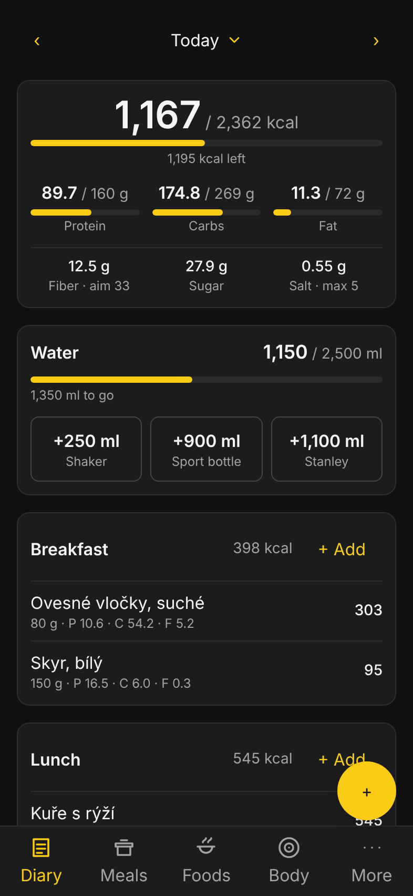
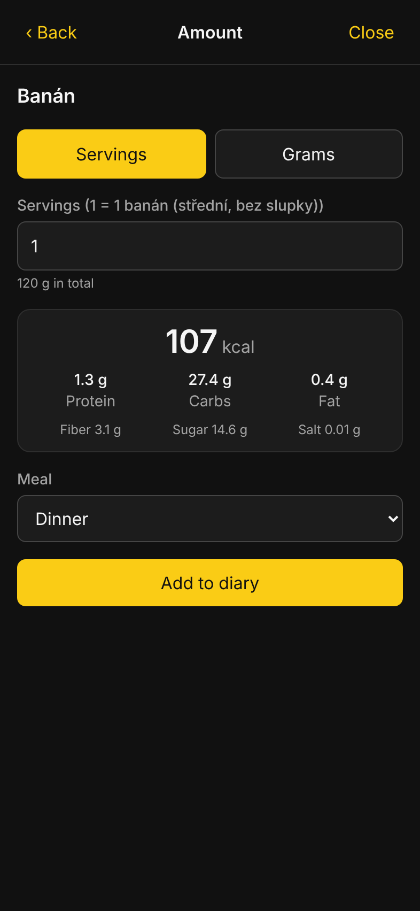
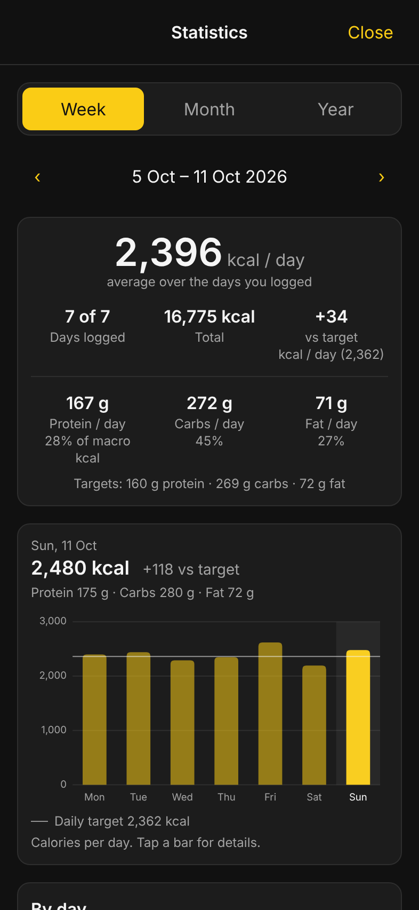
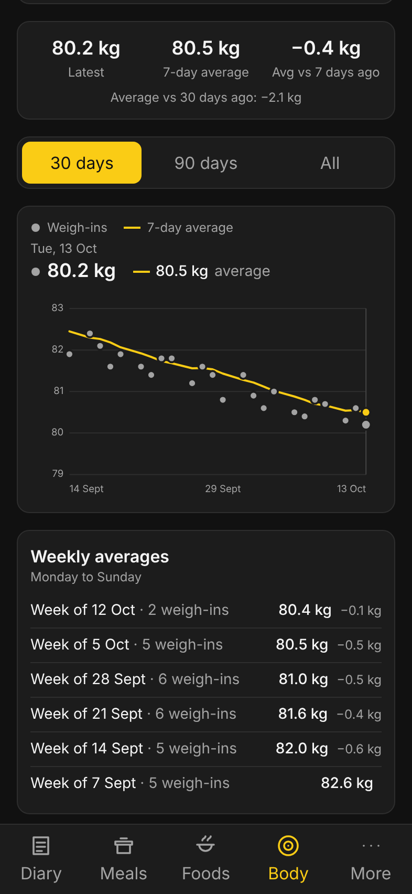
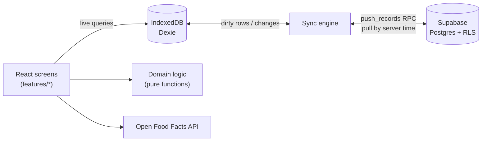

# Calorie Tracker

A mobile-first, offline-first calorie and macro tracker, built as an installable web app (PWA) for iPhone and desktop. It logs food from a search, a barcode scan or saved meals, tracks weight and water, computes daily targets, shows weekly to yearly statistics, and syncs between devices through Supabase.

This is my first project built with [Claude Code](https://claude.com/claude-code): I used it to practise AI-assisted development end to end, from the first brainstorm to a deployed app I use every day.

<p align="center">
  
  
  
  
</p>

<p align="center"><sub>Screenshots use demo data.</sub></p>

## Features

**Logging**
- Diary by day, grouped into breakfast, lunch, dinner and snacks, with calories, protein, carbs, fat, fiber, sugar and salt against daily targets.
- Food search that checks your saved foods first, then over 90 bundled everyday foods with Czech names (diacritics and Czech word endings are tolerated, so "kureci prsa" finds "Kuřecí prsa"), then [Open Food Facts](https://world.openfoodfacts.org) for packaged products.
- Barcode scanning with the camera, from a photo, or by typing the digits. Decoding runs in the browser (WebAssembly), so it works offline.
- Amounts in grams, millilitres or named portions such as "1 slice (20 g)". Scanning a barcode in the food form fills in the blank fields, including the portion size, without overwriting anything you typed.
- Saved meals (recipes) built from ingredients, logged by the serving. Each diary entry stores a snapshot of its nutrition, so editing a food or recipe later never rewrites past days.
- Month calendar to jump to any day, with a marker on days that have entries.

**Body and goals**
- Daily targets from the Mifflin-St Jeor formula, activity level and goal (cutting, maintenance, bulking), with a slider for the calorie adjustment and adjustable protein and fat per kilogram.
- Weight log with a 7-day moving average chart, weekly (Monday to Sunday) averages and trend changes.
- Water tracking with one-tap buttons for your own containers.

**Statistics**
- Week, month and year views: average calories per logged day, days logged, totals, difference to target, average macros and their split, and a bar chart with the target line. Days you did not log count as unknown, not as zero.

**Data**
- Offline-first: everything is stored on the device in IndexedDB, and the app shell is cached by a service worker, so it opens and works without a connection.
- Optional sync between devices (phone and desktop) through Supabase, with email and password sign-in.
- JSON export of all data as a backup that does not depend on any online service.

## Tech stack

| Area | Choice |
|---|---|
| Language | TypeScript (strict) |
| UI | React 19, Tailwind CSS 4, small hand-written components |
| Build | Vite 8, `vite-plugin-pwa` (Workbox service worker, web app manifest) |
| Local database | IndexedDB through Dexie 4 and `dexie-react-hooks` (live queries) |
| Sync backend | Supabase (Postgres, Auth, row level security) via `@supabase/supabase-js` |
| Barcode decoding | `zxing-wasm` (ZXing-C++ compiled to WebAssembly) |
| Food data | Open Food Facts API, plus a bundled list of basic foods |
| Charts | Hand-written SVG (no chart library) |
| Tests | Vitest and `fake-indexeddb` |
| Hosting | Cloudflare Pages (static), security headers via `_headers` |

## Architecture



- **Local-first.** Screens only read and write the local database. The network is used for food lookups and background sync, never to render a screen.
- **Pure domain layer.** Nutrition maths, targets, weight trends, statistics and calendar logic are plain functions with unit tests and no UI or database imports.
- **Sync.** Every row carries a UUID, an `updatedAt` time, a soft-delete marker and a local "dirty" flag. Changed rows are pushed through a Postgres function that keeps the newer edit; changes are pulled by the server's clock with a small overlap, so a device with a wrong clock cannot hide its changes. A deterministic merge keeps one profile and one weight per day when two devices create them before their first sync. One generic `records` table holds every entity, so the app can evolve its data model without server migrations. Full design: [docs/DESIGN.md](docs/DESIGN.md).

## Project structure

```
src/
  api/          Open Food Facts client (search, barcode lookup, parsing)
  components/   Shared UI (buttons, sheets, segmented control, toast)
  data/         Bundled basic foods and their search
  db/           Dexie schema and repository functions
  domain/       Pure logic: nutrition, targets, meals, weight, statistics, calendar, dates
  features/     Screens: diary, add-food, meals, foods, body (weight, water), targets, stats, settings
  platform/     iOS home-screen viewport fix
  sync/         Sync engine, sync manager, Supabase adapter and configuration
docs/           Design, security review, Supabase setup and SQL, screenshots
public/         Icons and security headers
```

## Getting started

Requirements: Node.js 22.

```bash
npm install
npm run dev        # development server on http://localhost:5173
npm test           # unit tests
npm run build      # type-check and production build into dist/
npm run preview    # serve the production build, with the production security headers
```

The app works without any configuration as a local-only tracker. To enable sync, create a free Supabase project and follow [docs/SUPABASE_SETUP.md](docs/SUPABASE_SETUP.md), then copy `.env.example` to `.env.local` and fill in:

```
VITE_SUPABASE_URL=https://<project-ref>.supabase.co
VITE_SUPABASE_PUBLISHABLE_KEY=sb_publishable_...
```

Camera access needs HTTPS (or `localhost`), so barcode scanning on a phone needs a deployed build.

## Deployment

The app is a static site. On Cloudflare Pages:

1. Connect the repository, with build command `npm run build` and output directory `dist` (Node 22 is picked up from `.node-version`).
2. Add `VITE_SUPABASE_URL` and `VITE_SUPABASE_PUBLISHABLE_KEY` under **Settings, Variables and Secrets** if you want sync.
3. Open the site in Safari on an iPhone and use **Share, Add to Home Screen** to install it as an app. On desktop, Chrome and Edge offer an install button in the address bar.

## Testing

- **231 unit tests** (Vitest) cover the domain logic, Open Food Facts parsing and retries, the database layer, and the sync engine. Sync is tested with two simulated devices against a fake server that applies the same rules as the SQL: edits and deletes travelling both ways, conflicting edits, paging, cursor handling, failures and merges.
- The Supabase schema and its row level security were tested on a local PostgreSQL 16 with stand-ins for Supabase's auth functions.
- During development every feature was also checked end to end in headless Chromium with Playwright, at phone size and under the production Content Security Policy, including a fake camera feed for barcode scanning and a mocked Supabase for sync. Those scripts were run ad hoc and are not part of the repository.

## Security and privacy

- Strict Content Security Policy and other security headers (`public/_headers`): scripts only from the app itself, no inline scripts or `eval`, network access only to the app, the configured Supabase project and Open Food Facts.
- Row level security in Supabase: a signed-in user can only read and write their own rows, and the public key alone can do nothing. Public sign-ups are meant to be disabled.
- No secrets in the repository. The Supabase URL and publishable key are public by design but still supplied at build time, so forks never point at someone else's project.

Details, accepted risks and the owner's checklist: [docs/SECURITY.md](docs/SECURITY.md).

## How it was built with Claude Code

The whole project was developed in conversation with Claude Code, working in milestones:

1. **Brainstorm and decisions.** Requirements, feasibility, and the main choices: a PWA instead of Flutter or a native app (free, no Mac or Apple developer account needed), Supabase for free sync, Open Food Facts for food data.
2. **Design document** with the data model, sync protocol and milestones, reviewed before any code ([docs/DESIGN.md](docs/DESIGN.md)).
3. **Scanner spike** to prove the riskiest part, barcode scanning in iOS Safari, on a real phone first.
4. **Core log, meals and targets, weight and water, sync, calendar and statistics**, each followed by testing on the iPhone and feedback in plain language: inconsistent search results, a missing photo-scan option, a theme change to yellow and black, layout tweaks.
5. **A security review** before going live, which added the Content Security Policy and hardened the database functions.

My part was the product: setting requirements, making the decisions, testing every build on the phone and reporting what was wrong. Claude Code wrote the code, the tests and the documentation, and verified each change before pushing.

One example of the debugging loop: the tab bar jumped on short screens only in the installed iPhone app, which could not be reproduced in a desktop browser. Claude Code added an on-device diagnostics panel; a single screenshot of it showed the viewport was 59 points shorter than the screen, exactly the status-bar height, whenever a page could not scroll. That pinned down an iOS quirk, and the fix was verified on the phone.

## Limitations and ideas

- The bundled basic foods are approximate reference values, not checked line by line against a food composition database.
- Foods saved separately on two devices (for example the same barcode) stay as two entries after syncing.
- Statistics compare against the current calorie target, since past targets are not stored.
- Not built yet: an adaptive calorie target based on the weight trend and logged intake.

## Data sources

- Packaged-food data from [Open Food Facts](https://world.openfoodfacts.org), available under the [Open Database License](https://opendatacommons.org/licenses/odbl/1-0/).
- The bundled basic foods use approximate reference values in line with standard food composition tables such as [USDA FoodData Central](https://fdc.nal.usda.gov) (public domain).

## Documentation

| Document | Contents |
|---|---|
| [docs/DESIGN.md](docs/DESIGN.md) | Goals, architecture, data model, sync protocol, screens, milestones |
| [docs/SECURITY.md](docs/SECURITY.md) | Security review, accepted risks, checks for the owner |
| [docs/SUPABASE_SETUP.md](docs/SUPABASE_SETUP.md) | Setting up the free Supabase project for sync |
| [docs/supabase-setup.sql](docs/supabase-setup.sql) | Database schema, row level security and sync function |
